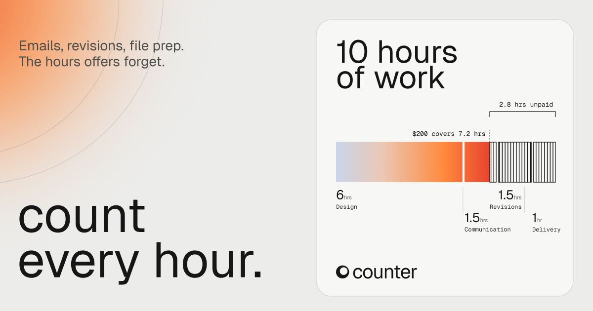
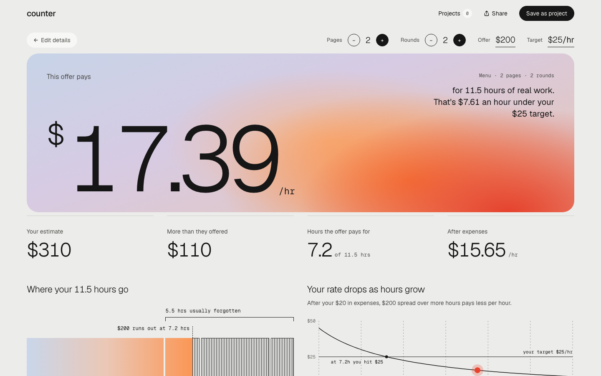
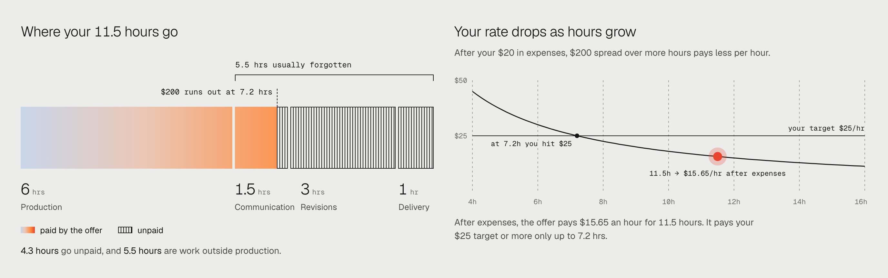
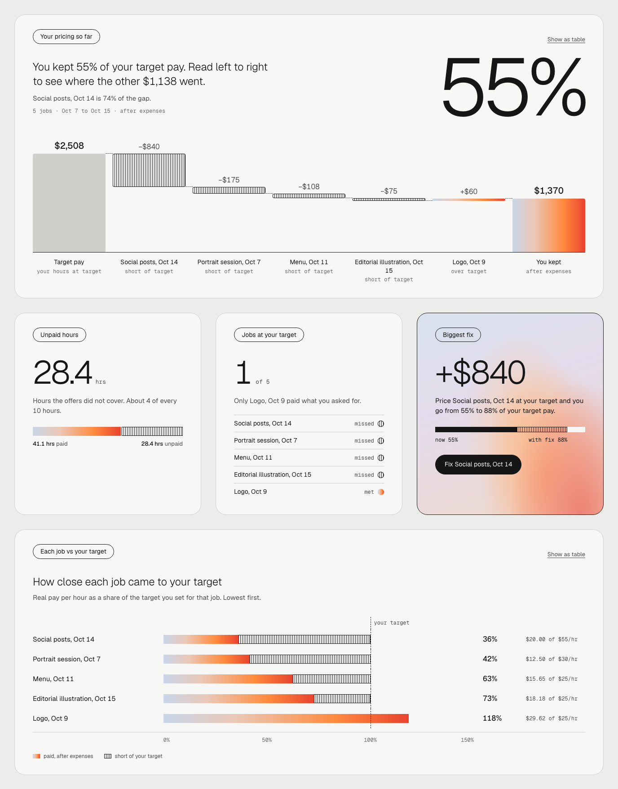
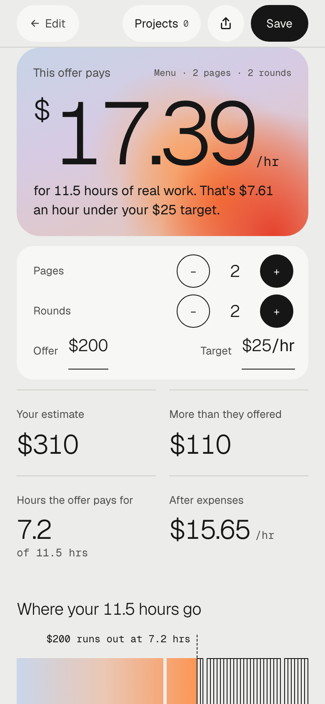

# Counter

[](https://github.com/kaylatgg/counter/actions/workflows/test.yml)

Designed by Kayla Tang

Counter helps you count all the work in a freelance job and see what an offer really pays per hour.

**Live:** https://kaylatgg.github.io/counter/



## The problem

Counter is for art and design students who are starting to take paid freelance work in graphic design, illustration, photography, and motion, like a restaurant menu, a portrait session, or a logo animation. They're trying to decide whether a client's offer is fair and what to reply, often before they know how many hours the job will really take. Existing pricing calculators are built for established freelancers who already know their rate: they multiply one guessed rate by one guessed number of hours, skip the emails, revisions, and file prep that eat a student's time, and never show what the offer actually pays per hour.

## The insight

Students price the work they can see. In the example menu job, 5.5 of the 11.5 hours are emails, revisions, and file prep, not design. That's almost half the job, and it's the half that goes unpaid. Every screen in Counter is built to make those hours visible, then show what the offer really pays for them.

## Data visualization

Each visual answers one question a student has while pricing a job.

| Visual | The question it answers | Why this form |
|---|---|---|
| Your work so far (screen 1) | Did I count everything? | A running total and one bar by type of work, updating as you type, so forgotten hours show up before you price. |
| Where your 11.5 hours go | Which hours does the offer pay for? | A bar per type of work: paid hours in the gradient, unpaid in stripes, a line where the money runs out, and a bracket over the usually forgotten work. |
| Your rate drops as hours grow | When does this job stop paying my target? | A line chart of pay per hour against hours, crossing the target line. Drag or use arrow keys to scrub any number of hours. |
| Ways to close the gap | What can I change? | Up to three cards, side by side on desktop, each with its option's work on one shared scale, so price and scope trade-offs compare at a glance. |
| Your pricing so far (waterfall) | Where did my money go across every job? | The bridge chart finance teams use in earnings reports, turned into rows on smaller screens: from target pay, each job's shortfall or gain, to what you kept. Every step adds up to the dollar. |
| Each job vs your target | Which jobs are underpriced? | A bullet chart: each job as a share of its own target, lowest first, so different targets compare on one scale. |







## Rules every chart follows

- One visual language: the gradient means paid, or the answer, and stripes mean unpaid.
- Every chart has a sentence that says what it shows, and the main ones state the takeaway.
- Values are labeled directly, not only in a legend.
- Color is never the only cue, so stripes still read in grayscale and for color blindness.
- Every chart has a screen reader summary, and the dashboard charts have a table view.

## Key design decisions

- Hours are grouped by type of work, so the work students forget (emails, revisions, file prep) is visible before they price.
- One visual language across every screen and chart, so nothing has to be learned twice.
- Every number adds up: the price shows its rounding, and the dashboard's waterfall reconciles to the dollar.
- Honest options: ways to close the gap never ask for less than the client offered, and the options and the dashboard compare rates to the target after expenses.

Every decision and the reason for it: [docs/DECISIONS.md](docs/DECISIONS.md).

## Designed for three real situations

**Ideal user:** a design student at a laptop with the client's email open, with time to think it through.
Change: a share link and Save image, so they can send the full breakdown straight to the client, plus a Projects dashboard that shows how their pricing is going across every job.

**Budget user:** an old laptop, no admin rights, spotty wifi.
Change: nothing to install and no account. Plain files load fast, and the fonts are stored with the site, so it doesn't wait on Google and still works on school networks that block it. Projects save in the browser, with no sign-in needed.

**Chaotic real-world user:** on a phone in a hallway between classes, 17 tabs open, no patience.
Change: the calculation autosaves, so closing the tab loses nothing. One-tap + and − buttons change the job's size (pages, posts, or seconds) and its rounds of changes without typing, and a bottom bar keeps the answer one tap away while scrolling.



## What else it does

- A ready-to-send reply to the client, written from the numbers.
- A share link and Save image, to send the breakdown.
- Projects that save in the browser.
- A Projects dashboard with one suggested fix.

## Accessibility

Built to WCAG AA: every text and control contrast passes, everything works with the keyboard only, screen readers hear a short summary of the result after each change, and with reduced motion on, nothing moves.

Lighthouse, October 18, 2026, on the live site (from [docs/QA-launch.md](docs/QA-launch.md)):

| Page | Mode | Performance | Accessibility | Best Practices | SEO |
|---|---|---|---|---|---|
| Screen 1 | mobile | 100 | 100 | 100 | 100 |
| Screen 1 | desktop | 100 | 100 | 100 | 100 |
| Screen 2 (result) | mobile | 100 | 100 | 100 | 100 |
| Screen 2 (result) | desktop | 100 | 100 | 100 | 100 |
| Projects | mobile | 100 | 100 | 100 | 100 |
| Projects | desktop | 100 | 100 | 100 | 100 |

Nothing loses points: the favicon and the meta description are in.

## How it's built

Plain HTML, CSS, and JavaScript, with no build step and no frameworks. The fonts are stored in the repo.

151 unit tests (97 for the math, 10 for share links, 44 for projects) run on every push. 18 browser tests run locally in Chromium and WebKit, at widths from 320 to 1440px.

In a production fintech build, I'd use TypeScript and store money in whole cents.

## Design process

- [docs/DESIGN.md](docs/DESIGN.md): the design system.
- [docs/DECISIONS.md](docs/DECISIONS.md): every decision and why.
- [docs/QA-launch.md](docs/QA-launch.md): the launch audit.

## Run it

Open `index.html` in a browser. There's no build step.

## Tests

```
npm run test:unit   # the math, share link, and projects tests (plain Node, no install needed)
npm test            # those, then the browser tests
```

The browser tests need Playwright and axe first. See [tests/e2e/README.md](tests/e2e/README.md).

## Credits

Fonts, test tools, and AI help: [CREDITS.md](CREDITS.md).

## License

© 2026 Kayla Tang. All rights reserved. Fonts are under the SIL Open Font License (see [fonts/OFL.txt](fonts/OFL.txt)).
